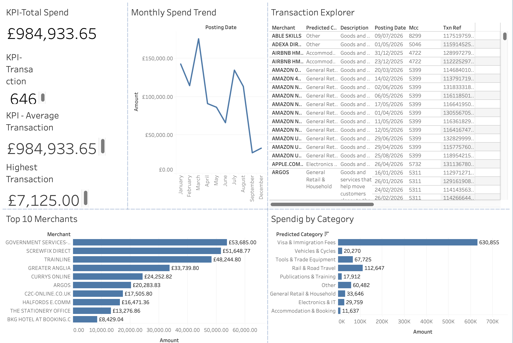

# Expense Intelligence

### GenAI-Assisted Audit & Analytics for Government Purchase-Card Spending

<p align="left">
  
  
  
  
  
</p>

An end-to-end data analytics and business intelligence project built using real UK Department for Work and Pensions (DWP) Government Procurement Card data.

Expense Intelligence combines Python-based data engineering, rule-based and LLM-assisted transaction categorisation, DuckDB analytics, and Tableau visualisation to transform raw financial transaction data into meaningful spending insights.

---

## Dashboard Preview

<p align="center">
  
</p>

<p align="center">
  <a href="YOUR_TABLEAU_PUBLIC_URL">
    <strong>View Interactive Tableau Dashboard →</strong>
  </a>
</p>

---

## Project Overview

Government purchase-card datasets contain valuable information about public expenditure, merchant activity, and spending behaviour. However, inconsistent CSV formats and unstructured transaction descriptions make financial analysis challenging.

Expense Intelligence aims to address this by developing an analytical pipeline that cleans, categorises, evaluates, and visualises government purchase-card transactions.

### Key Objectives

- Automate transaction data cleaning and preprocessing.
- Categorise expenses using merchant names and transaction descriptions.
- Evaluate categorisation against Merchant Category Codes (MCC).
- Analyse merchant-level and category-level spending.
- Explore spending patterns and potential anomalies.
- Present financial insights through an interactive Tableau dashboard.

---

## Dataset Overview

**Source:** UK Department for Work and Pensions (DWP) Government Procurement Card Data

**Licence:** Open Government Licence (OGL)

| Metric | Value |
|---|---:|
| Monthly source files | 9 |
| Raw transactions | 648 |
| Clean transactions | 648 |
| Unique transaction references | 646 |
| Unique merchants | 254 |
| Date range | 19 December 2025 – 17 September 2026 |
| Total recorded spend | £984,933.65 |

The original monthly CSV files contain inconsistencies in column headers, encodings, and numerical formats. These are handled during the data-loading and preprocessing stages.

---

## Technology Stack

| Technology | Purpose |
|---|---|
| Python | Data processing and analytics |
| Pandas | Data cleaning and manipulation |
| DuckDB | Analytical database |
| Tableau Public | Interactive data visualisation |
| LLM APIs | AI-assisted transaction categorisation |
| Git & GitHub | Version control |

---

## Data Pipeline

```text
             Raw DWP CSV Files
                     |
                     v
              Data Loading
                     |
                     v
          Cleaning & Preprocessing
                     |
                     v
          Standardised Transactions
                     |
                     v
           Expense Categorisation
                /          \
               v            v
          Rule-Based        LLM
               \            /
                v          v
          Categorisation Evaluation
                     |
                     v
                DuckDB Database
                     |
                     v
             Tableau Dashboard
                     |
                     v
              Spending Insights
```

---

## Categorisation & Evaluation

The project implements two approaches to transaction categorisation.

### 1. Rule-Based Categorisation

Uses merchant names, transaction descriptions, and predefined keyword rules to predict expense categories.

### 2. LLM-Based Categorisation

Uses an OpenAI-compatible API endpoint to classify transaction descriptions with a large language model.

### Rule-Based Evaluation Results

| Evaluation Metric | Result |
|---|---:|
| Categorisation agreement | 89.5% |
| Spend-weighted agreement | 93.9% |
| Merchant-level agreement | 84.2% |

### Evaluation Methodology

The categorisation system receives merchant names and transaction descriptions as input. Merchant Category Codes (MCC) are held back and used as reference labels for evaluation.

These figures represent agreement with MCC-derived labels, not independently validated classification accuracy. Source MCC disagreements may require manual review.

---

## Tableau Dashboard

An interactive Tableau Public dashboard designed to explore transaction-level and aggregated spending information.

### Key Performance Indicators

- **Total Spend:** Overall recorded expenditure.
- **Unique Transactions:** Number of distinct transaction references.
- **Average Transaction Value:** Average transaction amount.
- **Highest Transaction:** Largest individual transaction.

### Dashboard Visualisations

| Visualisation | Description |
|---|---|
| Monthly Spend Trend | Analyses expenditure over time. |
| Spending by Category | Compares expenditure across expense categories. |
| Top 10 Merchants | Identifies merchants with the highest recorded spend. |
| Transaction Explorer | Provides transaction-level details. |

**Live Dashboard:** [View on Tableau Public](YOUR_TABLEAU_PUBLIC_URL)

**Packaged Workbook:** `tableau/expense_dashboard.twbx`

---

## Project Structure

```text
expense-intelligence/
│
├── data/
│   ├── raw/
│   ├── processed/
│   └── gpc.duckdb
│
├── notebooks/
│
├── src/
│   ├── __init__.py
│   └── main.py
│
├── tests/
│
├── tableau/
│   ├── expense_dashboard.twbx
│   └── dashboard_screenshot.png
│
├── README.md
├── requirements.txt
└── .gitignore
```

---

## Installation & Setup

### 1. Clone the Repository

```bash
git clone YOUR_GITHUB_REPOSITORY_URL
cd expense-intelligence
```

### 2. Create a Virtual Environment

```bash
python3 -m venv .venv
```

### 3. Activate the Environment

**macOS / Linux**

```bash
source .venv/bin/activate
```

### 4. Install Dependencies

```bash
pip install -r requirements.txt
```

---

## Run the Pipeline

Execute the consolidated rules-based pipeline:

```bash
python src/main.py pipeline --backend rules
```

The pipeline processes transaction data and generates the analytical outputs.

---

## LLM Configuration

The project supports LLM-based categorisation through an OpenAI-compatible API endpoint.

For example, using Google's Gemini API:

```bash
export LLM_BASE_URL="https://generativelanguage.googleapis.com/v1beta/openai/"
export LLM_API_KEY="your_api_key"
export LLM_MODEL="your_model_name"
```

Run the LLM categorisation pipeline:

```bash
python src/main.py pipeline --backend llm
```

The API key should be stored securely and must never be committed to GitHub.

---

## Development Roadmap

- [x] Transaction data loading and cleaning
- [x] DuckDB database integration
- [x] Expense taxonomy
- [x] Rule-based categorisation
- [x] LLM categorisation implementation
- [x] Categorisation evaluation
- [x] Tableau dashboard
- [ ] Transaction anomaly detection
- [ ] Unusual spending pattern identification
- [ ] Ask-your-data AI assistant
- [ ] Advanced financial audit indicators

---

## Disclaimer

This project is developed for educational, analytical, and demonstration purposes using publicly available government procurement-card data.

Categorisation results depend on the quality of the source data and MCC reference labels. They should not be interpreted as independently verified audit findings.

---

<p align="center">
  <strong>Expense Intelligence</strong>
  <br />
  Built with Python · DuckDB · Tableau · AI
</p>